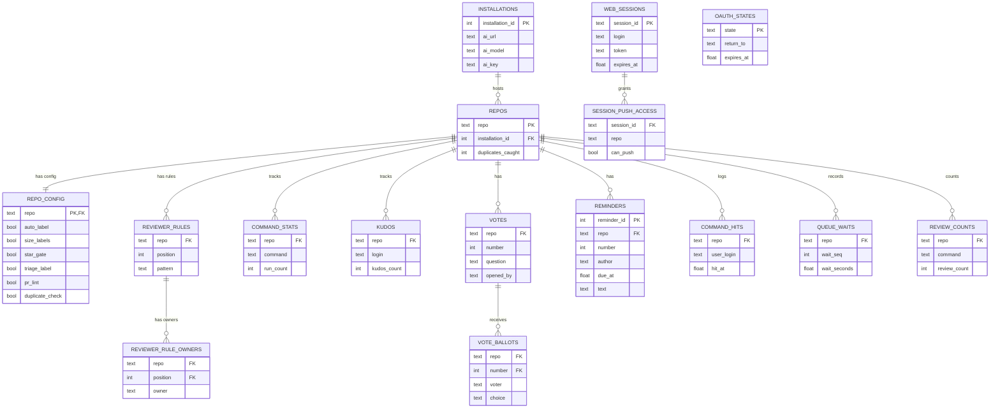

# Tidebot ER Diagram

This document describes the Entity-Relationship diagram for Tidebot's relational schema derived during normalization. The Mermaid diagram below covers all persistent tables (memory-only tables are shown with a note).

## ER Diagram

## Cardinalities explained

| Relationship | Type | Reason |
|---|---|---|
| `installations` → `repos` | 1 : N | One App installation can serve many repos |
| `repos` → `repo_config` | 1 : 1 | Every repo has exactly one `.tide.yml` config |
| `repos` → `reviewer_rules` | 1 : N | A repo can have many CODEOWNERS-style rules |
| `reviewer_rules` → `reviewer_rule_owners` | 1 : N | One glob pattern can map to many owners/teams |
| `repos` → `votes` | 1 : N | A repo can have votes on many issues (at most one open vote per issue number) |
| `votes` → `vote_ballots` | 1 : N | One vote gets one ballot per voter; voters may change their answer |
| `web_sessions` → `session_push_access` | 1 : N | One session stores push-access flags for all repos the user visited |

## Notes

- **`ai_key`** is nullable — installations that use a public endpoint don't need a key.
- **`installation_id`** in `repos` is nullable — a repo may be known before its installation webhook fires.
- **Memory-only tables** (`web_sessions`, `session_push_access`, `oauth_states`) are recreated empty on every restart; they appear in the ER diagram for completeness but are not persisted.
- **`reviewer_rules.position`** exists because CODEOWNERS semantics require order: the last matching rule wins.
- **`queue_waits`** keeps at most 200 rows per repo (`MAX_WAITS` in `metrics.py`) to bound state-file growth.
